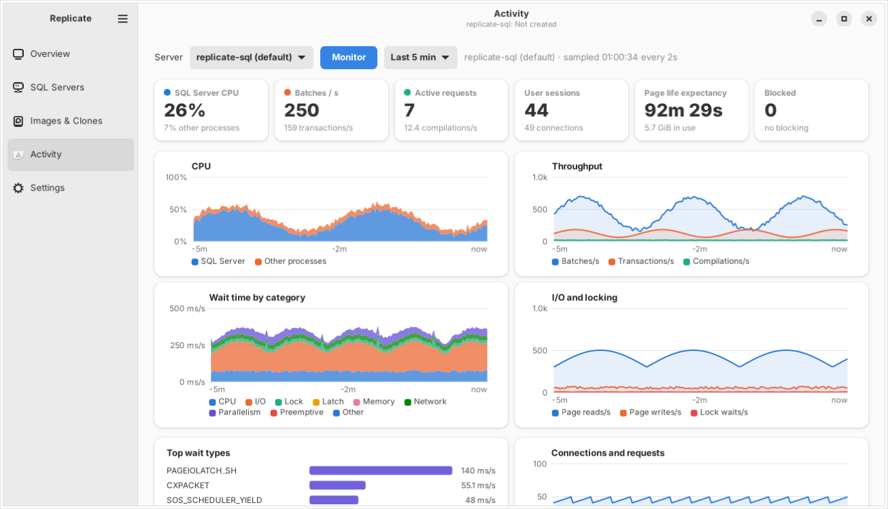
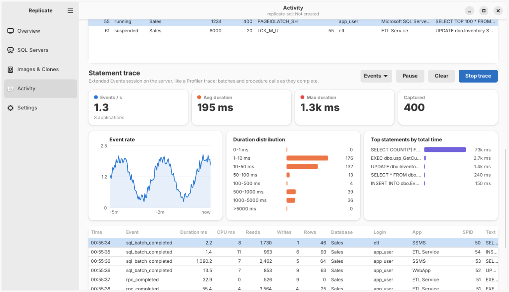
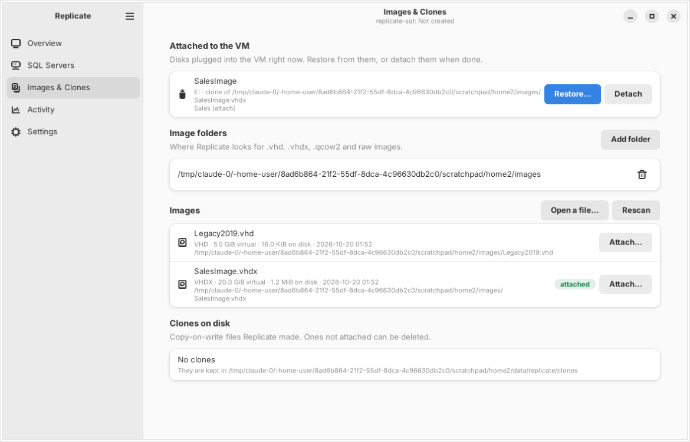
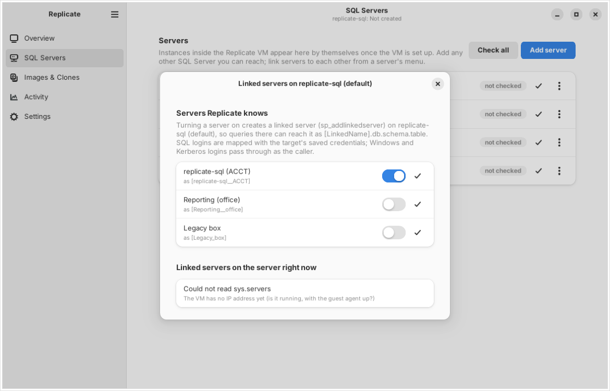

# Replicate

Restore SQL Server databases from VHD images into a Windows VM that Replicate
creates and runs for you on Linux, and watch what those servers are doing.

Replicate is a GTK 4 / libadwaita desktop app. It is free software
(GPL-3.0-or-later) and ships as an AppImage and a Nix flake.



| Statement trace | Images & clones | Linked servers |
| --- | --- | --- |
|  |  |  |

(Screenshots are rendered by `tools/smoke.py` with sample data; no VM was harmed.)

## What it does

- **Creates the SQL host VM in the background.** One dialog: pick a Windows 11
  ISO, set the instance names, type a password. Replicate writes an unattended
  install, defines a libvirt/KVM domain (UEFI, TPM, VirtIO, Hyper-V
  enlightenments), installs Windows, then SQL Server 2022 Developer with every
  instance you asked for, fixed TCP ports, a login for itself, and firewall
  rules. Close the app in the middle; the VM keeps installing and Replicate
  picks the progress back up when you return.
- **Runs the VM and the SQL Servers separately.** Start, shut down, pause and
  force off the VM; start and stop each SQL Server service on its own while the
  VM stays up. Service control goes through the QEMU guest agent, so it works
  with no network and no Windows password.
- **Takes VHD and VHDX images and makes databases out of them.** Point it at a
  folder of images: Hyper-V disks, `New-VHD` files, qcow2 or raw images,
  anything that holds data files or backups, in any subfolder, with or
  without a file extension (the format is read from the file itself). Attaching makes a copy-on-write clone (a qcow2 overlay; the image
  is never written to) and hot-plugs it into the VM. Windows brings the disk
  online, Replicate lists the `.mdf`/`.ldf`/`.ndf` and `.bak` files on it, and
  attaches the data files in place or restores the backups, with the names you
  choose. Many clones of one image cost nothing until they are written to.
- **Or skips the VM and runs SQL Server in Docker.** *Add Container* on the
  Overview page pulls Microsoft's SQL Server 2022 for Linux image, starts it
  with a generated `sa` password, publishes it on a local port and registers
  it as a server. Images attach to a container too: the clone is mounted on
  the Linux host (`qemu-nbd` plus the kernel's NTFS driver) inside a
  directory the container sees, and the databases are attached or restored
  from there; when SQL Server on Linux cannot open files where they are,
  Replicate copies them into the container instead. Windows authentication
  is the one thing containers cannot do.
- **Keeps a server list that is yours.** Instances inside the VM register
  themselves. Add any other SQL Server you can reach, with a SQL login, a
  Windows account and password, or the Kerberos ticket your Linux desktop
  already has, and link servers to each other: a switch per pair creates a
  linked server (`sp_addlinkedserver`) with the right login mapping, and tests
  it.
- **Shows activity like a profiler, as charts.** Live CPU (SQL Server vs. the
  rest), batches, transactions and compilations per second, wait time by
  category, I/O and locking, connections, the requests running right now, and
  a statement trace built on Extended Events: event rate, duration
  distribution, the statements costing the most time, and every captured batch
  or procedure call with its text.

Nothing in Replicate is tied to a particular company, domain or share. The
only things it needs from you are a Windows 11 ISO (Microsoft hands it out at
<https://www.microsoft.com/software-download/windows11>) and a machine with
KVM.

## Install

### AppImage

Download `Replicate-<version>-x86_64.AppImage` from the
[releases](https://github.com/tahuffman1s/Replicate/releases), make it
executable, run it. The AppImage bundles GTK, libadwaita, Python, python-tds,
`qemu-img`, `virsh` and `xorriso`. The host still needs:

- **libvirt** with its daemon running and your user in the `libvirt` group
  (`sudo usermod -aG libvirt,kvm $USER`, then sign in again). Replicate talks
  to `qemu:///system`.
- **KVM** (`/dev/kvm`), **swtpm** (Windows 11 needs a TPM) and **OVMF / edk2**
  firmware, which libvirt packages pull in on Fedora, Ubuntu, Debian and Arch.
  On Ubuntu: `sudo apt install libvirt-daemon-system qemu-system-x86 swtpm ovmf`.
- **virt-viewer** (optional) to see the VM's screen from the Overview page.

The AppImage mounts itself with FUSE when the system has it (FUSE 3 or
FUSE 2 both work) and extracts itself to a temporary directory when it does
not, so it runs either way; `--appimage-extract-and-run` forces the latter.

#### Fedora, Rocky Linux and other RHEL-family systems

```sh
sudo dnf install qemu-kvm libvirt virt-install swtpm swtpm-tools edk2-ovmf virt-viewer
sudo systemctl enable --now libvirtd
sudo usermod -aG libvirt,kvm $USER      # sign in again afterwards
```

`swtpm` is easy to forget; Windows 11 will not install without the TPM.
SELinux can stay enforcing: libvirt labels the VM disk and clone files
itself. Images on a network share need `setsebool -P virt_use_samba on` (CIFS)
or `virt_use_nfs on` (NFS). Home directories are created 0700 on these
systems, so either `chmod o+x ~` or point *Settings → Clones directory* at a
folder outside your home, so the qemu user can reach the clone files.
Machines joined with `realm join` already hold a Kerberos ticket in the KCM
cache at login; Replicate's Kerberos sign-in uses it as is.

### Nix / NixOS

```sh
nix run github:tahuffman1s/Replicate
```

The flake also has a NixOS module that sets libvirt up the way Replicate
expects (swtpm, OVMF with Secure Boot keys, the users in `libvirtd`):

```nix
{
  inputs.replicate.url = "github:tahuffman1s/Replicate";
  # ...
  imports = [ inputs.replicate.nixosModules.host ];
  programs.replicate = { enable = true; users = [ "you" ]; };
}
```

### From source

```sh
sudo apt install python3-gi python3-gi-cairo gir1.2-gtk-4.0 gir1.2-adw-1 \
    gir1.2-secret-1 qemu-utils libvirt-clients xorriso
pip install --user python-tds
python3 -m replicate
```

## Using it

1. **Settings** → set the Windows 11 ISO, press *Download* next to virtio-win,
   and list the instance names you want (`MSSQLSERVER` is the default
   instance; `MSSQLSERVER, ACCT` gives you two). Adjust memory and CPUs.
2. **Overview** → *Create the VM*. Enter a Windows password. The first time,
   Replicate asks for your administrator password once to write the disk into
   `/var/lib/libvirt/images` (or choose a directory you own in Settings).
   Windows takes 20–40 minutes, SQL Server another 10–20. *Open screen* shows
   the VM if you are curious; nothing needs clicking.
3. **SQL Servers** → the instances appear with their ports and the `replicate`
   login. *Check* tests a connection; the row's menu has *Linked servers…*,
   *Databases…* and *Watch activity*. *Add server* registers any other SQL
   Server.
4. **Images & Clones** → *Add folder* where your VHDs are, *Attach…* one. Pick
   a clone (recommended) or the image itself, and the restore dialog opens
   once Windows sees the disk: tick the databases, rename if you like,
   *Restore selected*. *Detach* later, optionally detaching the databases and
   deleting the clone.
5. **Activity** → choose a server, *Monitor* for the counters and charts,
   *Start trace* for the statement trace. *Events* picks which Extended Events
   to capture and a minimum duration.

Configuration lives in `~/.config/replicate/config.json`, state (which clones
are attached where) in `~/.local/share/replicate/state.json`, passwords in
your keyring (libsecret) or, without one, in a 0600 file next to the config.

### Windows authentication from Linux

Three ways to sign in to a server, chosen per server in *Add server*:

- **SQL Server login**: user name and password, kept in your keyring.
- **Windows account (password)**: domain, user name and password; Replicate
  authenticates with NTLM. Works against domain accounts and against local
  Windows accounts (use the machine name, or leave the domain blank).
- **Windows account (Kerberos ticket)**: no password stored anywhere.
  Replicate uses the ticket in this computer's credential cache, the same one
  `klist` shows, through GSSAPI. If there is no ticket, *Get Ticket…* in the
  dialog logs you in to the domain (or run `kinit user@REALM`); desktops
  joined with sssd or realmd have one from login already.

**With Kerberus.** [Kerberus](https://github.com/tahuffman1s/kerberus) is a
ticket manager for the same desktops: it signs in, keeps tickets renewed in
the background and can sign in again by itself with a saved password. When it
is installed (on PATH, or as an AppImage that left its autostart or desktop
entry behind, or pointed to in *Settings → Kerberos*), Replicate works with it
instead of around it: the server dialog shows the principals Kerberus holds
and which one matches the server, *Sign in with Kerberus…* opens Kerberus's
own sign-in dialog for that principal (starting Kerberus if it is not
running), and a connection that fails for want of a ticket offers the same.
Tickets Kerberus issues are the ones Replicate uses, because both go through
the machine's credential caches; nothing is copied between the two apps.

Kerberos needs, on the Linux side, the `python3-gssapi` bindings (bundled in
the AppImage and the Nix package) and a working `/etc/krb5.conf` for the
realm, which `realm join` or `sssd` write for you; otherwise DNS discovery
of the domain controllers is enough for most Active Directory domains. On
the SQL Server side the instance has to be reachable by a name that matches
its service principal (`MSSQLSvc/host.fqdn:port`), which SQL Server
registers itself when its service account is allowed to; the dialog has a
field to override the SPN when it is not. The Replicate VM's own instances
accept Kerberos once you join that VM to a domain; until then use the SQL
login the setup created, or a Windows account with the VM's name as domain.

### SQL Server in Docker, without the VM

Docker (or Podman) has to be installed with your user allowed to use it
(`sudo usermod -aG docker $USER` on most distributions). Each container is
`mcr.microsoft.com/mssql/server:2022-latest` (changeable in *Settings →
Docker*) with:

- `/var/opt/mssql` on a directory under `~/.local/share/replicate/docker/<name>/data`,
  so databases survive removing and recreating the container;
- `/mnt/replicate` bound to `.../<name>/mounts` with slave propagation, so
  an image mounted on the host after the container started is visible inside;
- a port on `127.0.0.1` only, `sa` as the login (password in your keyring),
  and a shared `replicate` Docker network so containers can be linked to each
  other by name.

Attaching an image for a container makes the usual copy-on-write clone, then
asks for your administrator password once to run the mount helper
(`replicate/vhd/mount_helper.py`, through polkit): it connects the clone to a
free `/dev/nbd` device with `qemu-nbd`, mounts every NTFS, ext4, XFS or exFAT
partition on it under the container's mounts directory owned by the `mssql`
user, and lists the database files. The restore dialog then attaches `.mdf`
files in place or restores `.bak` files, exactly as for the VM. Attaching in
place needs the kernel `ntfs3` driver (Linux 5.15 or newer); with the older
FUSE `ntfs-3g` driver SQL Server cannot open the files directly, and Replicate
copies them into the container's data directory and attaches those instead
(tick *Copy the files into the container* to do that from the start).

### How clones work

A clone is `qemu-img create -f qcow2 -b image.vhdx clone.qcow2`: QEMU reads
the VHDX directly and writes changes to the qcow2 file. The VM sees a normal
disk with a serial number Replicate chose; a PowerShell snippet run through the
guest agent finds the disk by that serial, brings it online, assigns drive
letters and lists database files. Databases are then attached with `CREATE
DATABASE … FOR ATTACH` or restored with `RESTORE DATABASE … WITH MOVE`, over a
normal TDS connection from the host.

Differencing VHDX disks (children of a parent VHDX) cannot be opened by QEMU;
merge them in Windows first (`Merge-VHD`) or use the parent image, which is
what you usually want anyway.

### The VM's own setup script

`replicate/guest/Setup-SqlHost.ps1` runs inside the VM at the first sign-in
and is safe to run again by hand (it is also on the `REPLICATE_SETUP` CD
attached to the VM). It installs SQL Server 2022 Developer for each instance
listed in `replicate.json`, sets fixed TCP ports (1433 for the default
instance, 14331, 14332, … for named ones), creates the `replicate` login as
sysadmin, and opens the firewall. Progress goes to
`C:\ProgramData\Replicate\setup-state.json`, which the host reads.

### When an image does not show up

The Images page says what the last scan went through (folders, files, how
many could not be read). From a terminal, the same scan explains itself per
file:

```sh
./Replicate-*.AppImage --scan /path/to/the/folder --all
```

Each image is listed with its format; with `--all` every skipped file is
listed with the reason (not readable as your user, too small, a name that
rules it out, no disk image signature). Files on a share mounted without
`uid=`/`file_mode=` options are a common cause of "cannot read".

## Development

```sh
nix develop            # or install the packages listed under "From source"
python3 -m pytest      # unit tests (the VHDX clone test needs qemu-img)
python3 tools/smoke.py # start the app, render every page to tools/screenshots/
packaging/appimage/build-appimage.sh   # on Ubuntu 24.04
```

Layout:

```
replicate/
  config.py, secrets.py, paths.py, tasks.py   configuration, keyring, threads
  vm/        libvirt domain XML, virsh wrapper, guest agent, unattended install, VM manager
  vhd/       image library, qcow2 clones, hot-plug + online in Windows, attach/restore T-SQL
  sql/       python-tds connection, server registry + linked servers, monitor, XE profiler
  guest/     Autounattend.xml.in, Setup-SqlHost.ps1 (go on the setup CD)
  ui/        libadwaita app: pages, dialogs, cairo charts
packaging/appimage/   appimage-builder recipe and script
flake.nix             package, dev shell, NixOS host module
```

## License

GPL-3.0-or-later. See `LICENSE`.
